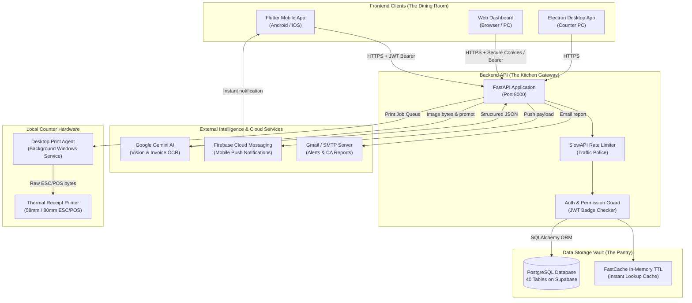
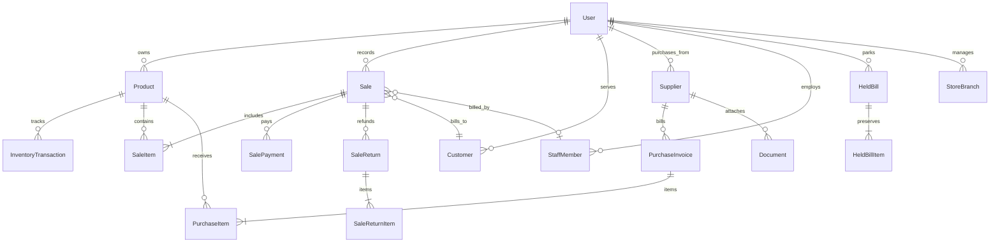

# DawaiFlow (ExpiryGuard) — Technical Architecture & Product Map
> **Document Purpose**: Complete, plain-English technical onboarding guide for the non-technical founder and leadership team.  
> **Target Audience**: Product owners, founders, business stakeholders, and incoming engineering leads.  
> **Rule of Thumb**: Plain English first. Technical terms explained on first mention. Real file paths cited throughout.

---

## 1. PRODUCT IN ONE PARAGRAPH

**DawaiFlow** (internally codebase-named **ExpiryGuard**) is an all-in-one smart pharmacy management system designed for Indian retail chemist shops and medical stores. From the store owner’s point of view, it turns a chaotic counter into a fast, effortless operation: a pharmacist points their phone or webcam at a medicine strip or shelf to bill it in seconds using Artificial Intelligence (AI) image recognition, speaks into the microphone in everyday Hindi or English to add items (*"2 patti Dolo 650 do"*), sells loose pills from opened strips without messing up inventory counts, and prints thermal receipts instantly. Behind the counter, the system protects the pharmacy's profits by sending automated phone alerts before expensive medicines expire on the shelf, tracks customer credit ("Khata" ledgers) with payment reminders, digitizes thick paper supplier invoices in one click, and automatically generates GST (Goods and Services Tax) reports ready to email to their Chartered Accountant (CA).

---

## 2. PROJECT TREE

Below is the complete organization of the codebase, divided by functional area. Every folder and important file includes a plain-English explanation of why it exists and what job it does.

### Mobile App (`flutter/`)
*The smartphone application pharmacists carry in their pockets or mount at the counter.*

```text
flutter/
├── pubspec.yaml                       # The mobile app's shopping list; declares package dependencies and version numbers.
├── analysis_options.yaml              # Code quality rulebook that warns developers about sloppy Flutter code.
├── android/                           # Native Android wrapper that compiles the Flutter app into an installable APK file.
│   ├── app/build.gradle.kts           # Android build recipe specifying app permissions, camera access, and SDK versions.
│   └── gradle/                        # Automated packaging tool that bundles the Android app.
├── lib/                               # The primary Flutter source code folder.
│   ├── main.dart                      # The ignition switch; the very first file that runs when the mobile app opens.
│   ├── screens/                       # The visual screens shown to the pharmacist.
│   │   ├── app_layout.dart            # The main dashboard frame; holds the navigation drawer, summary cards, and quick alerts.
│   │   ├── billing_screen.dart        # Counter billing screen; handles cart calculation, scanning, discounts, and payments.
│   │   ├── inventory_screen.dart      # Stock manager screen; search medicines, view batch numbers, and check stock levels.
│   │   ├── khata_screen.dart          # Customer credit book; lists outstanding balances and records partial cash/UPI payments.
│   │   ├── returns_screen.dart        # Medicine returns counter; allows one-tap restocking of returned patient medicines.
│   │   └── smart_action_center_screen.dart # Triage screen; highlights medicines that are already expired, expiring soon, or low in stock.
│   ├── services/                      # Code that fetches and sends data to the outside world.
│   │   └── api_service.dart           # The mobile messenger; makes HTTP calls to the backend server to fetch data and save bills.
│   ├── theme/                         # Visual styling and branding assets.
│   │   ├── app_colors.dart            # Brand color palette (emerald green, medical teal, alert red, alert amber).
│   │   ├── app_spacing.dart           # Standard screen spacing and padding dimensions.
│   │   ├── app_theme.dart             # Light and dark visual theme presets.
│   │   └── app_typography.dart        # Font sizing, font weights, and text styles.
│   └── widgets/                       # Reusable visual building blocks.
│       ├── status_badge.dart          # Color-coded badges indicating stock health ("Safe", "Expiring Soon", "Expired").
│       └── tabular_text.dart          # Monospaced number alignment widget for financial totals and currency amounts.
└── test/                              # Automated test scripts to verify mobile features before release.
    └── widget_test.dart               # Sanity check to confirm mobile UI elements render properly without crashing.
```

---

### Web Dashboard & Desktop App (`web/`, `desktop/`, `desktop_agent/`, `public_site/`)
*The web browser screens, desktop Electron wrapper, background receipt printer, and public website.*

```text
web/                                   # The browser-based pharmacy workstation running on desktop computers at the counter.
├── index.html                         # Login and registration portal for web browser users.
├── billing.html                       # Fast web counter POS (Point of Sale) with barcode, voice, and loose-tablet support.
├── inventory.html                     # Full-screen inventory control room for bulk editing, sorting, and batch inspection.
├── sales.html                         # Past sales receipt history with one-click PDF downloads and reprint triggers.
├── returns.html                       # Customer returns console to issue refunds and return medicines to stock.
├── smart_restock.html                 # AI reorder advisor calculating 7-day, 30-day, and 90-day sales demand patterns.
├── khata.html                         # Full customer ledger book managing credit limits, balances, and collection history.
├── suppliers.html                     # Supplier directory with ledger statements, contact numbers, and payment terms.
├── documents.html                     # Digital filing cabinet storing uploaded supplier invoices and OCR scan results.
├── ca_connect.html                    # Accountant sharing portal allowing one-click email export of monthly GST reports.
├── gst_filing.html                    # GST tax compliance overview tracking GSTR-1, GSTR-3B, and government deadlines.
├── staff.html                         # Employee management screen to add billing staff and set permission boundaries.
├── branches.html                      # Multi-store manager to configure warehouse and pharmacy branch locations.
├── backup.html                        # One-click backup and restore portal allowing encrypted shop data downloads.
├── settings.html                      # Shop profile settings (Drug License number, GSTIN, invoice prefixes, printer setup).
├── ai_billing.html                    # Experimental camera-based continuous visual counter scanner.
├── css/
│   └── styles.css                     # Master stylesheet defining the colors, layout grids, cards, and buttons.
└── js/                                # JavaScript files driving all web browser interactions.
    ├── api.js                         # Central HTTP communication hub linking the web pages to backend endpoints.
    ├── app.js                         # Common web page utilities (alerts, formatting rupees, dates, session guards).
    ├── app_preloader.js               # Performance booster; downloads medicine catalog in the background for instant search.
    ├── billing_flow.js                # The engine of the billing counter (cart calculations, tax splits, keyboard shortcuts).
    ├── voice_command_parser.js        # Speech-to-text interpreter converting spoken Hindi/English into cart quantities and items.
    ├── add_inventory_flow.js          # Modal workflow for adding new stock, auto-fetching HSN codes and GST percentages.
    ├── returns_flow.js                # Customer returns engine calculating refund totals and adjusting live inventory.
    ├── reports.js                     # Financial charting and export engine generating Excel spreadsheets.
    ├── staff.js                       # Logic for inviting staff, hashing permissions, and resetting counter passwords.
    ├── branches.js                    # Branch location switching and warehouse configuration logic.
    ├── migration.js                   # Wizard importing legacy data spreadsheets exported from Marg ERP, Vyapar, or Tally.
    ├── confirm_modal.js               # Reusable confirmation popups preventing accidental deletions.
    ├── nav.js                         # Sidebar navigation and responsive mobile menu toggler.
    └── i18n.js                        # Multi-language translation dictionary supporting English and Hindi UI labels.

desktop/                               # Electron desktop application wrapping the web dashboard as an installable Windows app.
├── package.json                       # Node.js project manifest declaring Electron runtime dependencies.
├── main.js                            # Desktop operating system window manager handling offline detection and window sizing.
├── preload.js                         # Secure bridge safely exposing printer and system commands to the web screen.
├── offline.html                       # Fallback screen shown if the pharmacy's broadband internet drops offline.
└── assets/                            # Desktop application icons (`icon.ico` for Windows, `icon.png` for Linux/Mac).

desktop_agent/                         # Standalone background Windows service that directly controls counter thermal receipt printers.
├── dawaiflow_print_agent.py           # Background Python daemon communicating with USB/Bluetooth/COM thermal printers.
├── config.json.example                # Configuration template specifying COM baud rate, paper width (58mm/80mm), and auth token.
├── setup_agent.bat                    # Windows batch script automatically installing Python dependencies for the printer.
├── run_agent.bat                      # Windows startup script running the thermal print agent in the system tray.
└── README.md                          # Quick setup guide for hardware technicians installing the printer agent in a pharmacy.

public_site/                           # Modern marketing website and pilot-request landing page built with React and Vite.
├── package.json                       # Node.js manifest specifying React, Vite, and Tailwind CSS dependencies.
├── vite.config.ts                     # Bundler settings compiling the marketing site into static production files.
├── index.html                         # Entry HTML file for the public landing page.
├── src/
│   ├── main.tsx                       # React application bootstrap script.
│   ├── App.tsx                        # Master layout organizing hero section, problem overview, pricing, and FAQ.
│   ├── components/                    # Modular website sections (Hero, ComparisonMatrix, PilotModal, FaqSection, etc.).
│   └── config/appConfig.ts            # Public API endpoint references and pilot request routing.
└── public/                            # Static images, marketing illustrations, `robots.txt`, and `sitemap.xml`.
```

---

### Backend (`app.py`, `database.py`, `dependencies.py`, `permissions.py`, `crypto_utils.py`, `scheduler.py`, `start_server.py`, `routes/`, `services/`, `ai/`)
*The engine room running on the server; validates data, calculates taxes, runs AI, and secures the database.*

```text
app.py                                 # The central backend assembly point; sets up security, rate limits, and connects all routes.
database.py                            # Database connection manager; connects to PostgreSQL, handles connection pools and SQLite fallbacks.
dependencies.py                        # Gatekeeper; verifies user logins, checks permission badges, and provides fast memory caches.
permissions.py                         # Access rules; defines who is allowed to do what (Owner, Pharmacist, Cashier, Accountant).
crypto_utils.py                        # High-security digital lockbox; encrypts staff recovery keys and backup files at rest.
scheduler.py                           # Automated background clock; runs recurring jobs like expiry checks and daily automated backups.
start_server.py                        # Server launch script starting Uvicorn to listen on web port 8000.
config.json                            # Local agent printer configuration file.

routes/                                # Specific API endpoint doorways grouped by business domain.
├── auth_routes.py                     # Doors for login, account creation, password resets, and session checks.
├── product_routes.py                  # Doors for managing medicines, barcode lookups, and inventory adjustments.
├── sale_routes.py                     # Doors for processing checkout sales, customer bills, and issuing refunds.
├── purchase_routes.py                 # Doors for wholesale distributor orders and supplier purchase records.
├── customer_routes.py                 # Doors for patient profiles, contact lists, and outstanding Khata debt.
├── ai_routes.py                       # Doors for AI camera scanning, voice command decoding, and AI assistant chat.
├── report_routes.py                   # Doors for generating sales velocity reports, daily profits, and tax summaries.
├── staff_routes.py                    # Doors for adding pharmacy team members and setting individual access limits.
├── setting_routes.py                  # Doors for saving pharmacy tax details, drug licenses, and receipt headers.
├── document_routes.py                 # Doors for uploading PDF/image invoices and checking digital filing status.
├── gst_routes.py                      # Doors for downloading GSTR-1 and GSTR-3B compliant tax filing sheets.
├── gst_reminder_routes.py             # Doors for checking upcoming tax deadlines and filing compliance status.
└── ca_routes.py                       # Doors for sending financial packages directly to the pharmacy's accountant.

services/                              # Specialized utility workers performing complex backend calculations.
├── pdf_generator.py                   # Digital print shop; renders professional, GST-compliant A4 invoice PDF files.
├── thermal_formatter.py               # Thermal receipt typesetter; converts sale details into ESC/POS raw printer bytes.
├── gst_calculator.py                  # Tax accountant; accurately splits CGST, SGST, and IGST according to Indian tax rules.
├── profit_calculator.py               # Financial analyst; compares purchase prices vs selling prices to report gross profit.
├── import_service.py                  # Spreadsheet reader; parses Excel and CSV inventory files with duplicate detection.
├── migration_service.py               # Legacy data converter; transforms messy exports from old pharmacy software into clean records.
├── notification_service.py            # Megaphone; sends push notifications to Android phones via Firebase Cloud Messaging.
├── email_service.py                   # Mailman; sends instant lead alert emails and financial reports via SMTP / Gmail.
├── google_gmail_service.py            # Direct Google OAuth connector allowing the server to email on behalf of the pharmacy.
└── template_generator.py              # Sample creator; provides downloadable Excel starter templates for new store imports.

ai/                                    # Artificial Intelligence and Computer Vision engine.
├── gemini_service.py                  # Google Gemini API connector; analyzes packaging photos to extract medicine details.
├── multi_item_scan_service.py         # Multi-strip scanner; detects several medicine boxes placed together on the counter.
├── invoice_service.py                 # Wholesale bill reader; scans multi-page distributor invoices into line items.
├── ocr_service.py                     # High-speed local vision engine using PaddleOCR and OpenCV for offline packaging text.
├── list_models.py                     # Utility script listing active AI models available under the configured Gemini API key.
├── test_ai_optimization.py            # Benchmark script verifying image compression speed and token efficiency.
├── backend/test_gemini.py             # Unit test verifying Google Gemini connectivity.
└── prompts/
    └── invoice_prompt.py              # The exact instruction manual sent to the AI model explaining how to read Indian invoices.
```

---

### Database Models (`models.py`, `crud.py`, `schemas.py`)
*The filing cabinet blueprints, business rules, and validation forms.*

```text
models.py                              # The database blueprint; defines all 40 relational tables, columns, and relationships.
crud.py                                # The database worker; contains the actual SQL queries to Create, Read, Update, and Delete data.
schemas.py                             # The strict border control forms (Pydantic models) validating incoming and outgoing data.
```

---

### Config, Deployment, & Auxiliary (`deploy/`, `credentials/`, `data/`, etc.)
*The shipping crates and instruction manuals used to host and maintain the app.*

```text
Dockerfile                             # Production recipe building a secure, lightweight Linux container running Python 3.13.
docker-compose.prod.yml                # Multi-container conductor orchestrating the backend API and database services together.
railway.json                           # Deployment configuration instructions for Railway cloud hosting.
.env.example                           # Template listing every required configuration setting and secret key name.
.dockerignore                          # Tells Docker which temporary files to ignore to keep server downloads small.
.gitignore                             # Tells Git source control never to upload secret passwords or temporary folders.
requirements.txt                       # Pinned list of all Python libraries required by the backend.
README.md                              # Main developer introduction and architectural summary.
deploy/                                # Server provisioning and automated deployment helper scripts.
credentials/                           # Secure local folder intended for private keys (e.g., Firebase service account JSON).
data/                                  # Seed data files including initial master medicine lists and HSN tax codes.
docs/                                  # Internal architecture notes and design documentation.
backups/                               # Storage folder for automated daily database snapshot files.
scripts/                               # Maintenance scripts for database verification, repairs, and migrations.
tools/                                 # Diagnostic utilities for stress-testing endpoints and inspecting caches.
tests/                                 # Backend automated test suite ensuring billing and inventory calculations stay accurate.
```

---

## 3. TECH STACK TABLE

| Technology | What job it does (*Plain English*) | Why it is here (*Business rationale*) | Where in the code it is used |
| :--- | :--- | :--- | :--- |
| **FastAPI** | Web framework (The restaurant kitchen) | Lightning-fast Python server engine that automatically creates API documentation and validates incoming data. | [`app.py`](file:///c:/Users/vashi/OneDrive/Desktop/ExpiryGuard_Backend/app.py), [`routes/`](file:///c:/Users/vashi/OneDrive/Desktop/ExpiryGuard_Backend/routes/) |
| **Python 3.13** | Backend programming language | The versatile language running all business logic, tax math, and AI connections. | Root backend scripts and services |
| **PostgreSQL (Supabase)** | Primary database (The master vault) | Ultra-reliable, industry-standard relational database that never loses financial or inventory records. | [`database.py`](file:///c:/Users/vashi/OneDrive/Desktop/ExpiryGuard_Backend/database.py), [`models.py`](file:///c:/Users/vashi/OneDrive/Desktop/ExpiryGuard_Backend/models.py) |
| **SQLAlchemy 2.0** | Object-Relational Mapper (Database translator) | Allows Python code to talk to the database using Python objects instead of writing raw SQL queries. | [`database.py`](file:///c:/Users/vashi/OneDrive/Desktop/ExpiryGuard_Backend/database.py), [`crud.py`](file:///c:/Users/vashi/OneDrive/Desktop/ExpiryGuard_Backend/crud.py) |
| **Pydantic v2** | Data validator (The strict inspector) | Guarantees that bad or missing data (like negative prices or corrupt phone numbers) is rejected immediately. | [`schemas.py`](file:///c:/Users/vashi/OneDrive/Desktop/ExpiryGuard_Backend/schemas.py) |
| **Flutter (Dart)** | Mobile framework (Smartphone app) | Builds high-performance, smooth Android and iOS apps from a single shared codebase. | Entire [`flutter/`](file:///c:/Users/vashi/OneDrive/Desktop/ExpiryGuard_Backend/flutter/) directory |
| **Vanilla JavaScript, HTML5, CSS3** | Web dashboard frontend | Zero-dependency, lightweight web dashboard that loads instantly even on low-end pharmacy counter PCs. | Entire [`web/`](file:///c:/Users/vashi/OneDrive/Desktop/ExpiryGuard_Backend/web/) directory |
| **Electron** | Desktop app packaging | Wraps the web dashboard into an installable Windows desktop application (.exe) with offline error screens. | Entire [`desktop/`](file:///c:/Users/vashi/OneDrive/Desktop/ExpiryGuard_Backend/desktop/) directory |
| **React + Vite + Tailwind CSS** | Public marketing website | Delivers a high-converting, visually stunning, lightning-fast public website for prospective customers. | Entire [`public_site/`](file:///c:/Users/vashi/OneDrive/Desktop/ExpiryGuard_Backend/public_site/) directory |
| **Google Gemini Vision (`google-genai`)** | AI Vision model (The expert eye) | Reads photos of medicine strips, packaging text, and multi-page supplier bills to extract medicine names, dates, and amounts. | [`ai/gemini_service.py`](file:///c:/Users/vashi/OneDrive/Desktop/ExpiryGuard_Backend/ai/gemini_service.py), [`ai/invoice_service.py`](file:///c:/Users/vashi/OneDrive/Desktop/ExpiryGuard_Backend/ai/invoice_service.py) |
| **PaddleOCR & OpenCV** | On-premise Computer Vision | Scans 1D barcodes, 2D QR codes, and reads packaging batch numbers locally on the machine without internet costs. | [`ai/ocr_service.py`](file:///c:/Users/vashi/OneDrive/Desktop/ExpiryGuard_Backend/ai/ocr_service.py) |
| **Web Speech API** | Voice recognition (The listener) | Converts the pharmacist's spoken voice in the browser into raw text for instant cart parsing. | Browser native; handled in [`web/js/billing_flow.js`](file:///c:/Users/vashi/OneDrive/Desktop/ExpiryGuard_Backend/web/js/billing_flow.js) |
| **Firebase Cloud Messaging (FCM)** | Push notifications (The pocket alert) | Sends silent and audible expiry warnings and low-stock reminders directly to the pharmacist's smartphone. | [`services/notification_service.py`](file:///c:/Users/vashi/OneDrive/Desktop/ExpiryGuard_Backend/services/notification_service.py) |
| **ReportLab** | PDF generation engine | Generates crisp, downloadable, GST-compliant A4 pharmacy tax invoices and customer receipts. | [`services/pdf_generator.py`](file:///c:/Users/vashi/OneDrive/Desktop/ExpiryGuard_Backend/services/pdf_generator.py) |
| **ESC/POS Command Protocol** | Thermal printer format | Generates the exact binary language spoken by 58mm and 80mm cash counter receipt printers. | [`services/thermal_formatter.py`](file:///c:/Users/vashi/OneDrive/Desktop/ExpiryGuard_Backend/services/thermal_formatter.py), [`desktop_agent/`](file:///c:/Users/vashi/OneDrive/Desktop/ExpiryGuard_Backend/desktop_agent/) |
| **APScheduler** | Background clock (Automated scheduler) | Runs automated maintenance in the background (purging 60-day old soft-deleted items, taking daily backups). | [`scheduler.py`](file:///c:/Users/vashi/OneDrive/Desktop/ExpiryGuard_Backend/scheduler.py) |
| **JWT (JSON Web Tokens) & Passlib / Bcrypt** | Security & Login system | Creates unforgeable digital ID badges (tokens) when users log in and scrambles passwords safely. | [`dependencies.py`](file:///c:/Users/vashi/OneDrive/Desktop/ExpiryGuard_Backend/dependencies.py), [`routes/auth_routes.py`](file:///c:/Users/vashi/OneDrive/Desktop/ExpiryGuard_Backend/routes/auth_routes.py) |
| **Cryptography (Fernet)** | Reversible AES encryption | Securely encrypts database backup snapshots and staff recovery passwords with high-grade cryptography. | [`crypto_utils.py`](file:///c:/Users/vashi/OneDrive/Desktop/ExpiryGuard_Backend/crypto_utils.py) |
| **SlowAPI** | Rate limiter (Traffic police) | Prevents servers from being overwhelmed by limiting how many requests an IP or user can send per minute. | [`dependencies.py`](file:///c:/Users/vashi/OneDrive/Desktop/ExpiryGuard_Backend/dependencies.py), [`app.py`](file:///c:/Users/vashi/OneDrive/Desktop/ExpiryGuard_Backend/app.py) |
| **Docker** | Containerization (Standard shipping box) | Packages the entire backend and all dependencies into a consistent environment that runs identically anywhere. | [`Dockerfile`](file:///c:/Users/vashi/OneDrive/Desktop/ExpiryGuard_Backend/Dockerfile), [`docker-compose.prod.yml`](file:///c:/Users/vashi/OneDrive/Desktop/ExpiryGuard_Backend/docker-compose.prod.yml) |
| **Railway** | Cloud hosting platform | Automatically deploys, hosts, and monitors the backend server whenever code updates are pushed. | [`railway.json`](file:///c:/Users/vashi/OneDrive/Desktop/ExpiryGuard_Backend/railway.json) |

---

## 4. HOW THE PARTS TALK TO EACH OTHER

### System Architecture Diagram



### In Plain English: How Data Moves
1. **The Request**: The pharmacist performs an action (e.g., clicks "Complete Sale" on the counter screen, speaks a voice command, or takes a photo of a medicine).
2. **The Messenger**: The screen (Mobile app, Web, or Electron desktop) bundles this request with the user's secret digital ID badge (the **JWT Bearer Token**) and sends it securely across the internet via HTTPS to the FastAPI server.
3. **The Gatekeeper**: The backend checks the token: *Is this person logged in? Which pharmacy do they own? Are they an Owner or a restricted Cashier?* If valid, it checks rate limits to make sure the server isn't being spammed.
4. **The Intelligence**: If the action involves a photo or voice, the backend calls Google Gemini or runs its local vision pipeline, extracting the exact medicine names, batch numbers, and prices.
5. **The Vault**: The backend locks the specific medicine rows in the PostgreSQL database, verifies stock quantities, subtracts the sold medicines, calculates the exact GST, and writes the finalized invoice.
6. **The Response & Hardware Kick**: The backend returns the confirmed bill to the screen. If the pharmacy has an attached receipt printer, the Desktop Print Agent claims the pending job and immediately prints the paper slip.

---

## 5. FEATURE WALKTHROUGHS

Here is exactly what happens behind the scenes for every major feature in DawaiFlow:

### 1. Scan-to-Bill (Camera / Vision Billing)
* **What the user does**: The pharmacist points their smartphone or counter webcam at a medicine strip or box and clicks "Scan".
* **Screen / Files handling it**:
  * Mobile: [`flutter/lib/screens/billing_screen.dart`](file:///c:/Users/vashi/OneDrive/Desktop/ExpiryGuard_Backend/flutter/lib/screens/billing_screen.dart) calling `ApiService.scanMultiItem()`
  * Web: [`web/billing.html`](file:///c:/Users/vashi/OneDrive/Desktop/ExpiryGuard_Backend/web/billing.html) and [`web/js/billing_flow.js`](file:///c:/Users/vashi/OneDrive/Desktop/ExpiryGuard_Backend/web/js/billing_flow.js)
* **Backend Endpoint called**: `POST /scan-multi-item` (or single `POST /scan-label` in [`routes/ai_routes.py`](file:///c:/Users/vashi/OneDrive/Desktop/ExpiryGuard_Backend/routes/ai_routes.py))
* **External Services called**: Google Gemini Vision (`gemini-3.8-flash` or `gemini-3.1-flash-lite`).
* **What gets saved in the Database**: Nothing is saved to the database yet. The backend queries [`products`](file:///c:/Users/vashi/OneDrive/Desktop/ExpiryGuard_Backend/models.py#L107) and [`medicine_catalog`](file:///c:/Users/vashi/OneDrive/Desktop/ExpiryGuard_Backend/models.py#L76) to match the AI-identified text with the store’s actual current stock and returns matched items to populate the counter cart.

### 2. Voice Billing (Natural Language / Hinglish Voice Input)
* **What the user does**: Pharmacist clicks the microphone icon and speaks naturally: *"Do patti dolo 650 aur ek loose cetirizine"* (Two strips of Dolo 650 and one loose tablet of Cetirizine).
* **Screen / Files handling it**:
  * Web: [`web/billing.html`](file:///c:/Users/vashi/OneDrive/Desktop/ExpiryGuard_Backend/web/billing.html), [`web/js/voice_command_parser.js`](file:///c:/Users/vashi/OneDrive/Desktop/ExpiryGuard_Backend/web/js/voice_command_parser.js), and [`web/js/billing_flow.js`](file:///c:/Users/vashi/OneDrive/Desktop/ExpiryGuard_Backend/web/js/billing_flow.js)
* **Backend Endpoint called**: `GET /billing/search-products?query=dolo%20650` in [`routes/sale_routes.py`](file:///c:/Users/vashi/OneDrive/Desktop/ExpiryGuard_Backend/routes/sale_routes.py)
* **External Services called**: Native browser Web Speech API (zero external server cost).
* **What gets saved in the Database**: No database write occurs during voice parsing. The local parser separates quantity (`2`), packaging type (`strip`), and medicine name (`dolo 650`). It then calls the backend search endpoint, automatically highlights the matching product, and adds it to the active cart.

### 3. Quick Batch Barcode Scan
* **What the user does**: The pharmacist scans a 1D barcode or 2D QR code printed on the medicine box using a barcode scanner gun or camera.
* **Screen / Files handling it**: [`web/js/billing_flow.js`](file:///c:/Users/vashi/OneDrive/Desktop/ExpiryGuard_Backend/web/js/billing_flow.js) or [`flutter/lib/screens/billing_screen.dart`](file:///c:/Users/vashi/OneDrive/Desktop/ExpiryGuard_Backend/flutter/lib/screens/billing_screen.dart)
* **Backend Endpoint called**: `GET /inventory/quick-batch-lookup?batch=...` in [`app.py`](file:///c:/Users/vashi/OneDrive/Desktop/ExpiryGuard_Backend/app.py) and [`routes/product_routes.py`](file:///c:/Users/vashi/OneDrive/Desktop/ExpiryGuard_Backend/routes/product_routes.py)
* **External Services called**: None. Uses local OpenCV barcode detector (`cv2.barcode`) or instant database indexed lookup.
* **What gets saved in the Database**: Reads the [`products`](file:///c:/Users/vashi/OneDrive/Desktop/ExpiryGuard_Backend/models.py#L107) table using exact batch matching, prefix matching, and fuzzy edit-distance fallback to instantly locate the exact batch and price.

### 4. Loose Tablet vs. Sealed Strip Inventory Billing
* **What the user does**: A patient only wants 3 tablets from a 10-tablet strip. The pharmacist selects unit type: "Loose Tablet" and enters quantity 3.
* **Screen / Files handling it**: [`web/js/billing_flow.js`](file:///c:/Users/vashi/OneDrive/Desktop/ExpiryGuard_Backend/web/js/billing_flow.js) and [`crud.py`](file:///c:/Users/vashi/OneDrive/Desktop/ExpiryGuard_Backend/crud.py) (`deduct_product_stock()`)
* **Backend Endpoint called**: `POST /sales` in [`routes/sale_routes.py`](file:///c:/Users/vashi/OneDrive/Desktop/ExpiryGuard_Backend/routes/sale_routes.py)
* **External Services called**: None.
* **What gets saved in the Database**: 
  * In [`products`](file:///c:/Users/vashi/OneDrive/Desktop/ExpiryGuard_Backend/models.py#L107): If the store has 0 loose tablets, the system automatically "breaks open" 1 sealed strip (`quantity` drops by 1), places the remaining 7 pills into `loose_tablet_stock`, and deducts 3 pills for the customer.
  * In [`sale_items`](file:///c:/Users/vashi/OneDrive/Desktop/ExpiryGuard_Backend/models.py#L353): Records `unit_type = "loose_tablet"`, unit price per pill, and the exact GST.

### 5. Pending Payments & Customer Khata (Credit Book)
* **What the user does**: A trusted patient takes medicines on credit, or pays ₹200 now and leaves ₹150 pending. Later, they visit the shop to pay the remaining balance.
* **Screen / Files handling it**:
  * Web: [`web/khata.html`](file:///c:/Users/vashi/OneDrive/Desktop/ExpiryGuard_Backend/web/khata.html)
  * Mobile: [`flutter/lib/screens/khata_screen.dart`](file:///c:/Users/vashi/OneDrive/Desktop/ExpiryGuard_Backend/flutter/lib/screens/khata_screen.dart)
* **Backend Endpoints called**: 
  * Checkout: `POST /sales` with payment method `CREDIT` or split payments (`CASH` + `CREDIT`).
  * Repayment: `POST /customers/{id}/payments` in [`routes/customer_routes.py`](file:///c:/Users/vashi/OneDrive/Desktop/ExpiryGuard_Backend/routes/customer_routes.py)
* **External Services called**: None (optional SMS/WhatsApp links generated client-side).
* **What gets saved in the Database**: 
  * In [`customers`](file:///c:/Users/vashi/OneDrive/Desktop/ExpiryGuard_Backend/models.py#L460): Updates `pending_amount` by adding credit or subtracting repayments.
  * In [`customer_payments`](file:///c:/Users/vashi/OneDrive/Desktop/ExpiryGuard_Backend/models.py#L649): Inserts an audit trail record of the cash/UPI collection.

### 6. Inventory Import (Excel, CSV, Marg / Vyapar Migration)
* **What the user does**: The owner uploads an Excel (.xlsx) or CSV file exported from their old software (like Marg ERP or Vyapar) to onboard their shop stock.
* **Screen / Files handling it**: [`web/inventory.html`](file:///c:/Users/vashi/OneDrive/Desktop/ExpiryGuard_Backend/web/inventory.html), [`web/js/migration.js`](file:///c:/Users/vashi/OneDrive/Desktop/ExpiryGuard_Backend/web/js/migration.js), [`services/migration_service.py`](file:///c:/Users/vashi/OneDrive/Desktop/ExpiryGuard_Backend/services/migration_service.py)
* **Backend Endpoint called**: `POST /inventory/import-preview` followed by `POST /inventory/import-confirm` in [`routes/product_routes.py`](file:///c:/Users/vashi/OneDrive/Desktop/ExpiryGuard_Backend/routes/product_routes.py)
* **External Services called**: None. Handled in Python using `openpyxl` and `pandas`.
* **What gets saved in the Database**: 
  * In [`data_migrations`](file:///c:/Users/vashi/OneDrive/Desktop/ExpiryGuard_Backend/models.py#L978): Records the import batch code, duplicate counts, and file stats.
  * In [`products`](file:///c:/Users/vashi/OneDrive/Desktop/ExpiryGuard_Backend/models.py#L107): Inserts all verified medicines, batches, and purchase prices.
  * In [`migration_errors`](file:///c:/Users/vashi/OneDrive/Desktop/ExpiryGuard_Backend/models.py#L1022): Logs any broken rows (e.g., negative stock, invalid date format) so the user can review them.

### 7. Automated Expiry & Low-Stock Push Notifications
* **What the user does**: Nothing. The system works automatically in the background while the pharmacist sleeps.
* **Screen / Files handling it**: [`scheduler.py`](file:///c:/Users/vashi/OneDrive/Desktop/ExpiryGuard_Backend/scheduler.py) and [`services/notification_service.py`](file:///c:/Users/vashi/OneDrive/Desktop/ExpiryGuard_Backend/services/notification_service.py)
* **Backend Endpoint called**: Background cron job running every 15 minutes.
* **External Services called**: Firebase Cloud Messaging (FCM).
* **What gets saved in the Database**: Queries [`products`](file:///c:/Users/vashi/OneDrive/Desktop/ExpiryGuard_Backend/models.py#L107) and [`notification_settings`](file:///c:/Users/vashi/OneDrive/Desktop/ExpiryGuard_Backend/models.py#L224). Updates product `status` to "Expiring Soon" or "Expired", records the timestamp of when the alert was dispatched, and delivers a push notification to the owner's phone.

### 8. PDF Bill Generation & Thermal Printing
* **What the user does**: Pharmacist completes a sale and clicks "Print Bill" or "Download PDF".
* **Screen / Files handling it**: 
  * PDF: [`services/pdf_generator.py`](file:///c:/Users/vashi/OneDrive/Desktop/ExpiryGuard_Backend/services/pdf_generator.py) via [`routes/sale_routes.py`](file:///c:/Users/vashi/OneDrive/Desktop/ExpiryGuard_Backend/routes/sale_routes.py)
  * Thermal: [`services/thermal_formatter.py`](file:///c:/Users/vashi/OneDrive/Desktop/ExpiryGuard_Backend/services/thermal_formatter.py) and [`desktop_agent/dawaiflow_print_agent.py`](file:///c:/Users/vashi/OneDrive/Desktop/ExpiryGuard_Backend/desktop_agent/dawaiflow_print_agent.py)
* **Backend Endpoint called**: `GET /sales/{id}/pdf` or `POST /sales/{id}/print`
* **External Services called**: None. Handled by ReportLab (PDF) or native Win32 Spooler / ESC/POS commands (Thermal).
* **What gets saved in the Database**: Inserts a record into [`print_jobs`](file:///c:/Users/vashi/OneDrive/Desktop/ExpiryGuard_Backend/models.py#L807) with status `PENDING`. When the local print agent picks it up, the status transitions to `PRINTING` and finally `PRINTED`.

### 9. Login & Multi-Shop Data Separation
* **What the user does**: Pharmacist or staff member enters their email/username and password.
* **Screen / Files handling it**: [`web/index.html`](file:///c:/Users/vashi/OneDrive/Desktop/ExpiryGuard_Backend/web/index.html), [`flutter/lib/services/api_service.dart`](file:///c:/Users/vashi/OneDrive/Desktop/ExpiryGuard_Backend/flutter/lib/services/api_service.dart), [`routes/auth_routes.py`](file:///c:/Users/vashi/OneDrive/Desktop/ExpiryGuard_Backend/routes/auth_routes.py)
* **Backend Endpoint called**: `POST /login`
* **External Services called**: None.
* **What gets saved in the Database**: Verifies password hash using `bcrypt`. Issues an encrypted JSON Web Token (JWT) containing `user_id` (the pharmacy shop ID) and optional `staff_id`. Every single subsequent database query is filtered strictly by `user_id = current_user.id`.

---

## 6. THE AI PART

DawaiFlow uses Artificial Intelligence as a high-speed data entry assistant, eliminating the tedious typing traditionally required in pharmacy software.

### Where the AI Code Lives
* **Invoice Prompts**: [`ai/prompts/invoice_prompt.py`](file:///c:/Users/vashi/OneDrive/Desktop/ExpiryGuard_Backend/ai/prompts/invoice_prompt.py) (The exact prompt engineering instructions for distributor purchase bills).
* **Medicine Packaging Scanner**: [`ai/gemini_service.py`](file:///c:/Users/vashi/OneDrive/Desktop/ExpiryGuard_Backend/ai/gemini_service.py) (Packaging label OCR and field extraction).
* **Multi-Item Shelf Scanner**: [`ai/multi_item_scan_service.py`](file:///c:/Users/vashi/OneDrive/Desktop/ExpiryGuard_Backend/ai/multi_item_scan_service.py) (Multi-item detection from single counter photos).
* **Purchase Bill Digitizer**: [`ai/invoice_service.py`](file:///c:/Users/vashi/OneDrive/Desktop/ExpiryGuard_Backend/ai/invoice_service.py) (Multi-page invoice stitching and financial reconciliation).
* **AI Chat Assistant (RAG)**: [`crud.py`](file:///c:/Users/vashi/OneDrive/Desktop/ExpiryGuard_Backend/crud.py#L5573-L5727) (Database-grounded pharmacy conversational assistant).

### What is Sent to the AI Model
1. **The System Prompt**: A detailed set of pharmaceutical domain rules instructing the AI to read Indian medicine packaging, look specifically for keywords like "MRP", "Batch No", "Exp Date", convert dates to standard `YYYY-MM-DD`, and extract Price to Retailer (PTR) without confusing it with MRP.
2. **The Image Bytes**: The photograph taken by the user. Before being sent, images larger than 800 KB are compressed and optimized in memory via Pillow ([`ai/gemini_service.py:122-146`](file:///c:/Users/vashi/OneDrive/Desktop/ExpiryGuard_Backend/ai/gemini_service.py#L122-L146)) to reduce latency and token costs.
3. **Configuration**: The AI is instructed to return `temperature = 0.0` (zero creativity, 100% strict adherence to facts) and `response_mime_type = "application/json"`.

### What Comes Back from the AI Model
A strict, structured JSON object:
```json
{
  "supplier_name": "CA Connect Pharmaceuticals",
  "invoice_number": "INV-2026-9041",
  "invoice_date": "2026-07-29",
  "subtotal": 6135.60,
  "tax_amount": 294.50,
  "total_amount": 6100.57,
  "items": [
    {
      "product_name": "ELTROXIN 75 MCG TAB",
      "batch_number": "3W41",
      "quantity": 10,
      "free_qty": 0,
      "ptr": 110.0,
      "mrp": 150.0,
      "gst_rate": 5.0,
      "expiry_date": "2028-03-01",
      "confidence": 0.95
    }
  ]
}
```

### Error Handling & Rate Limits
* **API Key Safety Proxy**: [`ai/gemini_service.py:23-44`](file:///c:/Users/vashi/OneDrive/Desktop/ExpiryGuard_Backend/ai/gemini_service.py#L23-L44) uses a lazy proxy client. If `GEMINI_API_KEY` is missing or invalid, the backend still boots cleanly for standard billing and displays friendly configuration alerts instead of crashing.
* **Friendly Translation of Errors**: In [`routes/ai_routes.py:39-83`](file:///c:/Users/vashi/OneDrive/Desktop/ExpiryGuard_Backend/routes/ai_routes.py#L39-L83), raw technical errors are sanitized to remove secret keys and translated into human-friendly messages:
  * Google 429 quota exhaustion becomes: *"Gemini API rate limit or quota exceeded. Please try again in a few moments."*
  * Corrupted images become: *"Uploaded image file is empty or has an invalid image signature."*
  * Unreadable photos become: *"AI response received, but no medicine information could be extracted. Please ensure packaging text is clearly visible."*
* **Endpoint Rate Limiting**: AI endpoints are rate-limited via SlowAPI (e.g., maximum 60 camera scans per minute, 30 supplier invoice scans per hour) to prevent runaway costs from accidental double-taps.

### Approximate Cost Per Request
* **Model Used**: `gemini-3.8-flash` or `gemini-3.1-flash-lite`.
* **Token Usage per Single Medicine Scan**: ~400 input tokens (image + prompt) + ~100 output tokens.
  * Cost: Approximately **$0.00015 USD (around 1.2 paise INR)** per scan.
* **Token Usage per Full Purchase Invoice (Page)**: ~1,200 input tokens + ~800 output tokens.
  * Cost: Approximately **$0.0005 USD (around 4 paise INR)** per invoice page.
* *Summary*: The AI cost is exceptionally low—1,000 medicine scans cost less than ₹15 INR.

---

## 7. DATABASE EXPLAINED

DawaiFlow's database consists of **40 tables** structured into clear business domains. Every single business record belongs to a specific pharmacy (`user_id`).

### Simplified Entity-Relationship Diagram



---

### Plain-English Table Directory (All 40 Tables)

#### 1. Core Pharmacy & User Accounts
1. **`users`**: The central pharmacy account. Stores shop name, owner name, login email, scrambled password, drug license number, GSTIN, address, and invoice preferences.
2. **`device_tokens`**: Stores the unique digital addresses of owners' Android smartphones to deliver Firebase push notifications.
3. **`notification_settings`**: Stores the owner's preferences for alerts (how many days before expiry to alert, digest schedules, sound/vibration toggles).
4. **`store_branches`**: Stores branch locations and warehouses for multi-store pharmacy chains.
5. **`staff_members`**: Stores logins and roles for counter pharmacists, cashiers, and inventory clerks.

#### 2. Medicine Catalog & Stock Inventory
6. **`medicine_catalog`**: Master reference encyclopedia of Indian medicines, standard brand names, formulations, pack sizes, and default HSN tax codes. Contains no stock quantities.
7. **`products`**: The pharmacy's actual live inventory. Stores medicine name, batch number, current quantity of sealed strips, loose tablet stock, purchase price, MRP, and expiry date.
8. **`inventory_transactions`**: The chronological stock audit log. Records every addition or deduction of stock (who sold it, what bill it was on, or which supplier delivered it).
9. **`hsn_tax_rates`**: Official government tax table mapping 4-digit HSN codes (like 3004) to their mandated GST rates (0%, 5%, 12%, 18%).
10. **`unmapped_hsn_logs`**: Watchlist table logging any unfamiliar HSN codes encountered on invoices for administrator review.
11. **`marked_for_return`**: Staging table of near-expiry medicines flagged by the pharmacist to send back to distributors for credit notes.
12. **`priority_sales`**: Quick-action shelf list of near-expiry medicines that pharmacists want to discount and sell first.

#### 3. Sales, Counter Billing, & Returns
13. **`sales`**: The master sales receipt book. Stores bill number, date, customer name, total amounts, GST totals, doctor details, and payment status.
14. **`sale_items`**: The individual rows inside a bill. Freezes the exact medicine name, batch, expiry date, tax rate, and price charged at that exact moment.
15. **`sale_payments`**: Audit table recording how a bill was paid (e.g. ₹500 split into ₹300 UPI and ₹200 Cash).
16. **`sale_returns`**: The refund logbook. Tracks returned medicines, total refund amount, reason, and date.
17. **`sale_return_items`**: Individual line items inside a return receipt, tracking the exact batch restored to inventory.
18. **`held_bills`**: Parked draft carts. If a customer steps away to get cash, their cart is parked here so the pharmacist can serve the next customer.
19. **`held_bill_items`**: The medicines saved inside a parked cart.

#### 4. Customers & Khata (Credit Book)
20. **`customers`**: Patient contact directory. Stores name, mobile number, address, fixed discounts, and their current outstanding Khata debt.
21. **`customer_payments`**: Ledger recording repayments made by patients clearing their pending credit balance.

#### 5. Suppliers & Wholesale Procurement
22. **`suppliers`**: Distributor directory. Stores distributor names, GSTIN, phone numbers, state, and payment terms (e.g. Net 30).
23. **`documents`**: Digital document locker. Stores uploaded supplier invoice PDFs/images, file sizes, and AI extraction status.
24. **`purchase_invoices`**: Digital ledger of wholesale bills received from suppliers, including invoice number, date, and payment status.
25. **`purchase_items`**: The line items inside a supplier invoice (quantities received, wholesale rate, batch numbers, and expiry dates).
26. **`supplier_payments`**: Tracks payments made by the pharmacy to clear distributor balances.
27. **`purchase_returns`**: Tracks goods returned back to the wholesale distributor due to damage or expiry.
28. **`purchase_return_items`**: Specific batches and quantities returned to distributors.

#### 6. Hardware & Printing
29. **`printer_devices`**: Registered counter thermal printers (USB, Bluetooth, or Network spoolers) and paper sizes (58mm / 80mm).
30. **`print_jobs`**: Print queue. Stores frozen JSON receipt data waiting to be picked up by the local desktop print agent.

#### 7. CA Connect & Tax Compliance
31. **`ca_profiles`**: Contact information for the pharmacy's Chartered Accountant or tax consultant.
32. **`ca_share_logs`**: Audit trail of monthly financial reports emailed to the accountant.
33. **`gst_filing_logs`**: History of official government tax returns (GSTR-1, GSTR-3B) marked as filed by the owner.
34. **`gst_due_date_overrides`**: Government deadline extension rules (e.g., if the tax department extends filing dates).
35. **`user_google_oauth`**: Encrypted refresh tokens allowing the system to email tax packages directly through the user's Gmail account.

#### 8. Data Migration, Backups, & Leads
36. **`data_migrations`**: Tracks historical data imports from legacy pharmacy software (Marg, Vyapar, Excel).
37. **`migration_errors`**: Detailed row-by-row error logs for invalid rows during an import.
38. **`backup_records`**: Catalog of encrypted database backup files available for one-click download or restore.
39. **`restore_logs`**: Safety audit log tracking who restored a database backup and verification results.
40. **`pilot_leads`**: Public website contact submissions from pharmacies requesting early access to DawaiFlow.

---

## 8. SECURITY AND DATA SEPARATION

### How Login Works
* **Password Hashing**: Passwords are never saved in plain text. When a user creates a password, it is pre-hashed using SHA-256 (preventing a known security issue where passwords over 72 characters get truncated) and then scrambled using **Bcrypt** with a unique random salt ([`dependencies.py:49-57`](file:///c:/Users/vashi/OneDrive/Desktop/ExpiryGuard_Backend/dependencies.py#L49-L57)).
* **Session Tokens (JWT)**: When login succeeds, the server issues a digitally signed JSON Web Token (JWT). The token contains the shop ID and staff role, expires automatically after 7 days, and is validated on every single HTTP request.

### How One Pharmacy's Data is Kept Separate from Another's (Multi-Tenancy)
* **The Apartment Building Analogy**: Think of DawaiFlow as a secure apartment building. All pharmacies share the same building foundation (the database server), but every pharmacy has its own locked private apartment (`user_id`).
* **Enforced Query Scoping**: Every database table storing business data contains a mandatory `user_id` column. In [`crud.py`](file:///c:/Users/vashi/OneDrive/Desktop/ExpiryGuard_Backend/crud.py), every single database read, search, update, or delete includes a mandatory filter:
  ```python
  query = db.query(models.Product).filter(models.Product.user_id == current_user.id)
  ```
  It is mathematically impossible for Pharmacy A to view or modify Pharmacy B's inventory, sales, or customer lists because the user ID is extracted from the cryptographic token and cannot be faked.

### Where Secrets and API Keys are Stored
* **Environment Variables**: Sensitive credentials (database passwords, Google Gemini API keys, Firebase service keys, JWT signing keys) are never written into source code files.
* **Storage Location**: Secrets live exclusively in an untracked `.env` file on the production server (or in Railway's secure environment settings vault).
* **Git Protection**: The `.gitignore` file strictly prohibits `.env`, `credentials/`, or database snapshots from being uploaded to GitHub or public repositories.

### Protections in Place
1. **Pessimistic Concurrency Locking**: During checkout ([`crud.py:1083-1087`](file:///c:/Users/vashi/OneDrive/Desktop/ExpiryGuard_Backend/crud.py#L1083-L1087)), product rows are locked using SQL `with_for_update()`. This prevents "race conditions" where two cashiers might sell the exact same last strip of medicine at the same microsecond.
2. **Idempotency Protection**: When a bill is finalized, the client generates a unique `idempotency_key`. If a cashier double-clicks the button or the counter internet stutters, the server recognizes the key and prevents duplicate charges or double stock deductions.
3. **Cross-Site Request Forgery (CSRF) Guard**: In [`app.py:98-122`](file:///c:/Users/vashi/OneDrive/Desktop/ExpiryGuard_Backend/app.py#L98-L122), state-changing requests (`POST`, `PUT`, `DELETE`) submitted with browser cookies must originate from verified domain names, blocking malicious third-party websites.
4. **Rate Limiting**: SlowAPI restricts brute-force password guessing attempts to 10 per minute per IP address.

---

## 9. HOW IT GOES LIVE

### Production Infrastructure & Hosting
* **API Backend Server**: Hosted on **Railway** (or Docker-compatible cloud hosts like AWS, DigitalOcean, or Google Cloud Run).
* **Database**: Hosted on **Supabase Managed PostgreSQL**, utilizing the Supabase Transaction Connection Pooler on port `6543` to support thousands of simultaneous mobile and desktop connections.
* **Mobile Distribution**: Compiled into an Android application package (`.apk`) downloadable directly from the API static file server (`https://api.dawaiflow.com/static/dawaiflow-latest.apk`) or Google Play Console.
* **Web & Marketing Hosting**: The web counter is served directly by FastAPI from [`web/`](file:///c:/Users/vashi/OneDrive/Desktop/ExpiryGuard_Backend/web/), while the public landing site is compiled into static HTML/CSS/JS in [`public_site/dist/`](file:///c:/Users/vashi/OneDrive/Desktop/ExpiryGuard_Backend/public_site/).

### Deployment Steps (Code to Production)
1. **Code Push**: Developer pushes verified code to the production branch on GitHub.
2. **Container Build**: Railway detects the commit, reads [`Dockerfile`](file:///c:/Users/vashi/OneDrive/Desktop/ExpiryGuard_Backend/Dockerfile), and initiates a 2-stage build:
   * *Stage 1 (Builder)*: Installs C compilers and compiles Python libraries into a virtual environment (`/opt/venv`).
   * *Stage 2 (Runner)*: Copies only the clean virtual environment into a hardened, non-root Python 3.13 Linux image.
3. **Database Migration**: On startup, [`app.py:140-156`](file:///c:/Users/vashi/OneDrive/Desktop/ExpiryGuard_Backend/app.py#L140-L156) runs automatic database table verification, ensuring all new tables and columns exist.
4. **Health Check Probe**: Railway queries `GET /health`. If the server responds with HTTP 200 and `"database": "connected"`, the new version is switched live with zero downtime.

### Environment Variables Required in Production (*Names Only*)
```text
ENVIRONMENT                     # Must be set to 'production' on live servers
PORT                            # Port number for the web server (defaults to 8000)
DATABASE_URL                    # PostgreSQL connection string pointing to Supabase
SECRET_KEY                      # 64-character random cryptographic secret for JWT signing
ALLOWED_ORIGINS                 # Comma-separated list of allowed web domains (e.g. dawaiflow.com)
GEMINI_API_KEY                  # Google AI Studio API key for Gemini Vision models
GEMINI_PRIMARY_MODEL            # Model identifier (e.g. gemini-3.8-flash)
REDIS_URL                       # Connection string for distributed rate limiting (optional)
FIREBASE_CREDENTIALS_JSON       # Firebase service account credentials for push notifications
FIREBASE_CREDENTIALS_PATH       # Alternative local path to Firebase credentials file
SMTP_HOST                       # Email server address (e.g. smtp.gmail.com)
SMTP_PORT                       # Email server port (587 for TLS)
SMTP_USER                       # Sending email address
SMTP_PASS                       # 16-character Google App Password (never the main account password)
MY_EMAIL                        # Founder email address where new pilot signups are delivered
SMTP_FROM_NAME                  # Display name for system alert emails
CREDENTIAL_ENCRYPTION_KEY       # Master key for encrypting stored staff passwords
BACKUP_ENCRYPTION_KEY           # Master key for encrypting database backup archives
```

---

## 10. RISKS AND WEAK SPOTS

An honest engineering appraisal of current weak spots, technical debt, and areas requiring attention as the user base expands.

| Risk / Weak Spot | Severity | Plain-English Explanation of the Risk | What Happens if it Breaks? | Recommended Solution |
| :--- | :---: | :--- | :--- | :--- |
| **Heavy Local OCR Dependencies** | **HIGH** | PaddleOCR and OpenCV are included in the backend repository. They consume substantial RAM (~600MB to 1GB) on server startup. | On cheap server tiers ($5/mo), the server may run out of memory (OOM crash) during simultaneous OCR scans. | Run PaddleOCR inside a dedicated microservice or rely exclusively on Gemini Vision for cloud OCR. |
| **Silent SQLite Fallback** | **HIGH** | If `DATABASE_URL` fails or is misconfigured, [`database.py`](file:///c:/Users/vashi/OneDrive/Desktop/ExpiryGuard_Backend/database.py#L13-L15) silently defaults to a local file (`dawaiflow.db`). | If cloud hosting restarts, data written to the temporary local file will vanish, causing data loss. | Change the code to crash hard and fail fast with a clear error if PostgreSQL is unreachable in production. |
| **In-Memory Rate Limiting by Default** | **MEDIUM** | SlowAPI defaults to local memory (`memory://`) unless Redis is explicitly configured in `.env`. | If multiple server instances are run behind a load balancer, each server tracks limits independently, weakening DDoS protection. | Provision a small Upstash or Redis instance when scaling beyond a single server container. |
| **Open Registration Endpoint** | **MEDIUM** | `POST /register` currently allows anyone on the internet to create a pharmacy account without email verification or OTP checks. | Spammers or bots could create thousands of empty dummy stores, cluttering the database. | Implement mobile number OTP verification (via Twilio, MSG91, or Firebase Auth) before activating accounts. |
| **Single-Page Electron Desktop Wrapper** | **LOW** | The desktop app ([`desktop/main.js`](file:///c:/Users/vashi/OneDrive/Desktop/ExpiryGuard_Backend/desktop/main.js)) loads the remote web URL rather than embedding local offline databases. | If the pharmacy's broadband internet drops, billing stops until the connection returns (shows `offline.html`). | Build local SQLite offline-first synchronization with background cloud reconciliation for zero-downtime billing. |
| **Lack of Automated POS Stress Tests** | **LOW** | There are unit tests for algorithms, but no automated end-to-end load tests simulating 20 cashiers billing concurrently. | Unforeseen database deadlocks could theoretically appear during peak evening pharmacy rushes (7 PM - 10 PM). | Introduce Locust or k6 load tests simulating 50 concurrent checkouts per second. |

---

## 11. GLOSSARY

Every technical term used in this document, explained simply:

* **API (Application Programming Interface)**: The waiter in a restaurant. Takes orders from the mobile app or browser, delivers them to the backend kitchen, and brings back the result.
* **Authentication**: The digital passport check. Verifies that users are who they claim to be using passwords or tokens.
* **Authorization / RBAC (Role-Based Access Control)**: The VIP pass. Determines what an authenticated user is permitted to do (e.g. an Owner can delete inventory; a Cashier can only bill).
* **Backend**: The server-side engine room and kitchen. Computes tax math, verifies stock, and talks to the database.
* **Bcrypt**: A military-grade cryptographic algorithm that irreversibly scrambles passwords so they can never be stolen from a leaked database.
* **Cache (TTL)**: A high-speed temporary memory whiteboard. Keeps frequently requested data (like medicine search lists) in quick-access memory for a short Time-To-Live (TTL).
* **Concurrency / Pessimistic Locking**: An electronic lock placed on a database row to ensure two cashiers cannot sell the same physical box of medicine at the same time.
* **CORS (Cross-Origin Resource Sharing)**: A browser security rulebook preventing unauthorized foreign websites from making requests to the pharmacy backend.
* **CSRF (Cross-Site Request Forgery)**: A web attack where a malicious website tricks a logged-in user's browser into performing unwanted actions. Blocked in DawaiFlow by origin verification.
* **Docker / Container**: A standardized software shipping container that packages code and all its tools together so it runs reliably on any computer or cloud server.
* **Electron**: A technology that packages a website inside a desktop application wrapper so it runs like a native Windows or Mac program (.exe).
* **ESC/POS**: The universal command language understood by thermal cash counter receipt printers (paper cutters, bold fonts, cash drawer kicks).
* **Fernet Encryption**: An authenticated symmetric encryption standard (AES-128) where data is scrambled with a key and can only be unscrambled with the same key.
* **Flutter**: Google’s mobile app toolkit for writing code once and generating apps for Android and iOS phones.
* **Frontend**: The visual screens, buttons, and user interfaces that the pharmacist interacts with on their phone, tablet, or monitor.
* **GSTIN**: Goods and Services Tax Identification Number; the official 15-character tax registration code assigned to an Indian business.
* **HSN Code (Harmonized System of Nomenclature)**: Standard 4-digit code (such as `3004` for medicines) used by the Indian tax department to determine mandatory GST rates.
* **Idempotency**: An architectural guarantee that sending the exact same checkout request twice (due to network retries) will only create one bill and deduct stock once.
* **JWT (JSON Web Token)**: A compact, digitally signed temporary badge given to a user when they log in. Carried in the header of every subsequent request.
* **OCR (Optical Character Recognition)**: Computer vision technology that converts photographs of printed text into editable, searchable computer text.
* **ORM (Object-Relational Mapper)**: A software bridge (SQLAlchemy) translating database tables and SQL queries into native Python objects.
* **RAG (Retrieval-Augmented Generation)**: An AI technique where the system queries the store's private database first, and gives those exact facts to the AI model so it cannot hallucinate.
* **Soft Delete**: Instead of permanently destroying a database record, the system marks a flag (`is_deleted = True`), hiding it from the screen while allowing a 60-day recovery window.

---

## 12. NEW-DEVELOPER ONBOARDING STEPS

If a new software engineer joins the team tomorrow, here are the exact steps they should follow to get DawaiFlow running on their development machine, along with the first files they should read.

### Exact Local Setup Instructions

#### Step 1: Clone the Repository & Setup Python Environment
```bash
# 1. Open terminal and enter project directory
cd ExpiryGuard_Backend

# 2. Create an isolated Python 3.11 or 3.13 virtual environment
python -m venv venv

# 3. Activate the virtual environment
# On Windows (PowerShell):
.\venv\Scripts\Activate.ps1
# On Mac/Linux:
source venv/bin/activate

# 4. Install backend dependencies
pip install --upgrade pip
pip install -r requirements.txt
```

#### Step 2: Configure Environment Variables
```bash
# Copy the template environment configuration
cp .env.example .env

# Edit .env using any text editor:
# - Set ENVIRONMENT=development
# - Ensure SECRET_KEY is set (or generate via: python -c "import secrets; print(secrets.token_hex(32))")
# - Set GEMINI_API_KEY (obtain a free key from https://aistudio.google.com/)
# - If you don't have a Supabase PostgreSQL URL yet, leave DATABASE_URL empty to use local SQLite!
```

#### Step 3: Run the Backend Server
```bash
python start_server.py
```
*The server will start up on `http://127.0.0.1:8000`. You can test it by opening your browser to `http://127.0.0.1:8000/health` or viewing interactive API documentation at `http://127.0.0.1:8000/docs`.*

#### Step 4: Open the Web Dashboard
* Open your browser and navigate to `http://127.0.0.1:8000/web/index.html`.
* You can register a test pharmacy or log in immediately.

#### Step 5: (Optional) Run the Mobile App
```bash
cd flutter
flutter pub get
flutter run
```

---

### The Top 5 Files Every New Developer Must Read First

1. [`models.py`](file:///c:/Users/vashi/OneDrive/Desktop/ExpiryGuard_Backend/models.py)  
   *Why read it first*: It is the DNA of the application. It defines how data is structured, how pharmacies are separated, and how inventory, sales, and customers link together.
2. [`crud.py`](file:///c:/Users/vashi/OneDrive/Desktop/ExpiryGuard_Backend/crud.py)  
   *Why read it second*: It contains the core business logic of the product. Specifically inspect `create_sale_transaction()` (lines 1025–1518) and `deduct_product_stock()` (lines 869–1023) to understand how loose-tablet billing, pricing tiers, and tax math operate.
3. [`app.py`](file:///c:/Users/vashi/OneDrive/Desktop/ExpiryGuard_Backend/app.py)  
   *Why read it third*: It reveals how the whole system connects: middleware, rate limiters, security guards, background task warmups, and where the 12 domain route files are mounted.
4. [`dependencies.py`](file:///c:/Users/vashi/OneDrive/Desktop/ExpiryGuard_Backend/dependencies.py)  
   *Why read it fourth*: It shows how security works on every request. Reading this file explains how the current user is identified from their token, how role permissions are enforced, and how in-memory caching speeds up responses.
5. [`ai/gemini_service.py`](file:///c:/Users/vashi/OneDrive/Desktop/ExpiryGuard_Backend/ai/gemini_service.py) & [`ai/prompts/invoice_prompt.py`](file:///c:/Users/vashi/OneDrive/Desktop/ExpiryGuard_Backend/ai/prompts/invoice_prompt.py)  
   *Why read it fifth*: It demonstrates how the AI vision pipeline operates, showing how photographs are compressed, how domain prompts are constructed, and how JSON outputs are validated.
